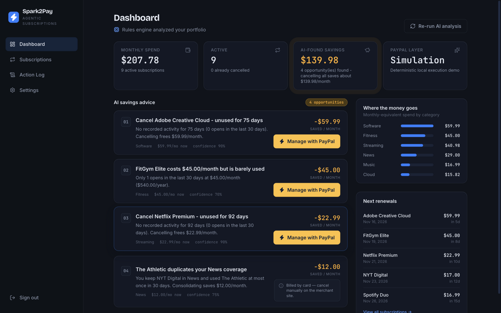
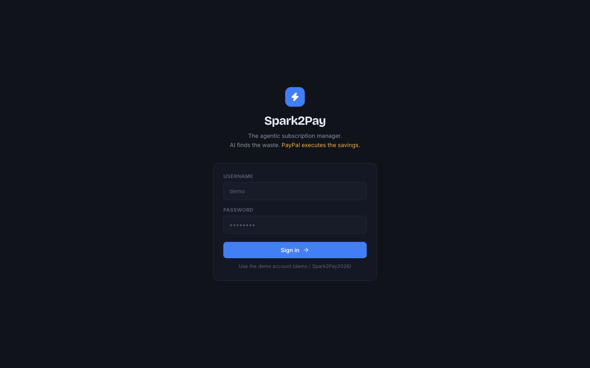
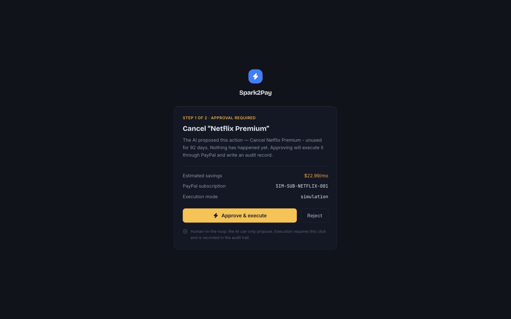
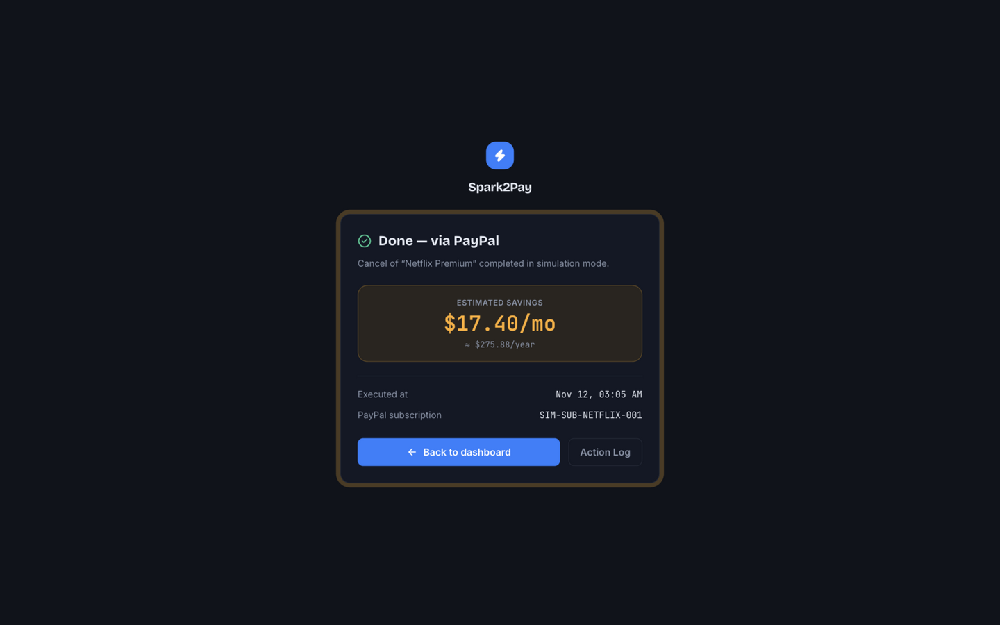
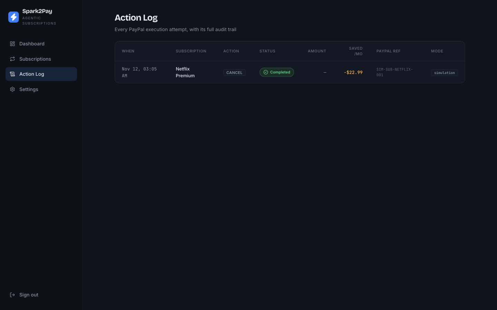
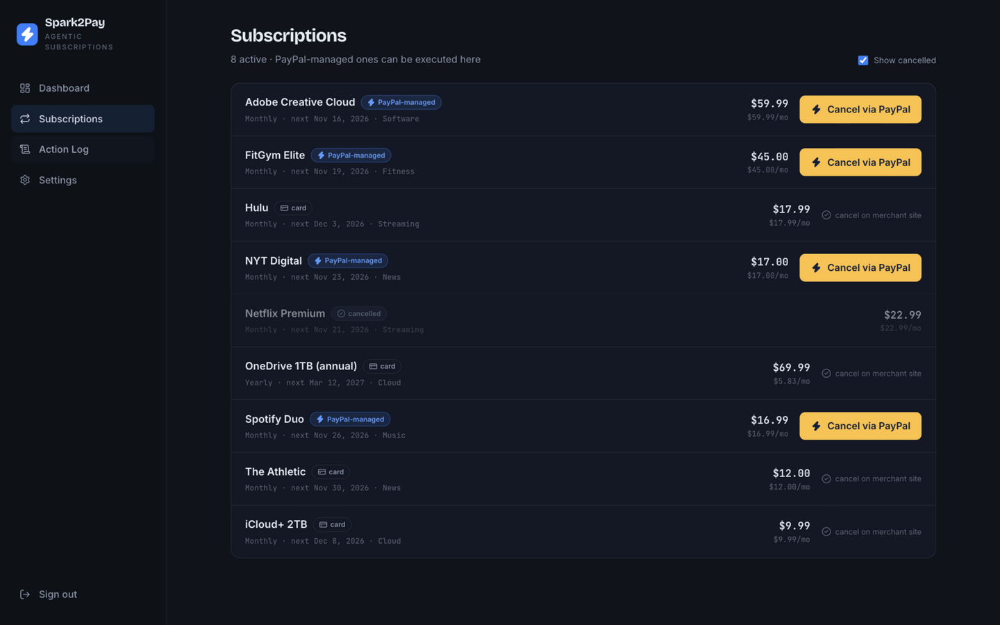
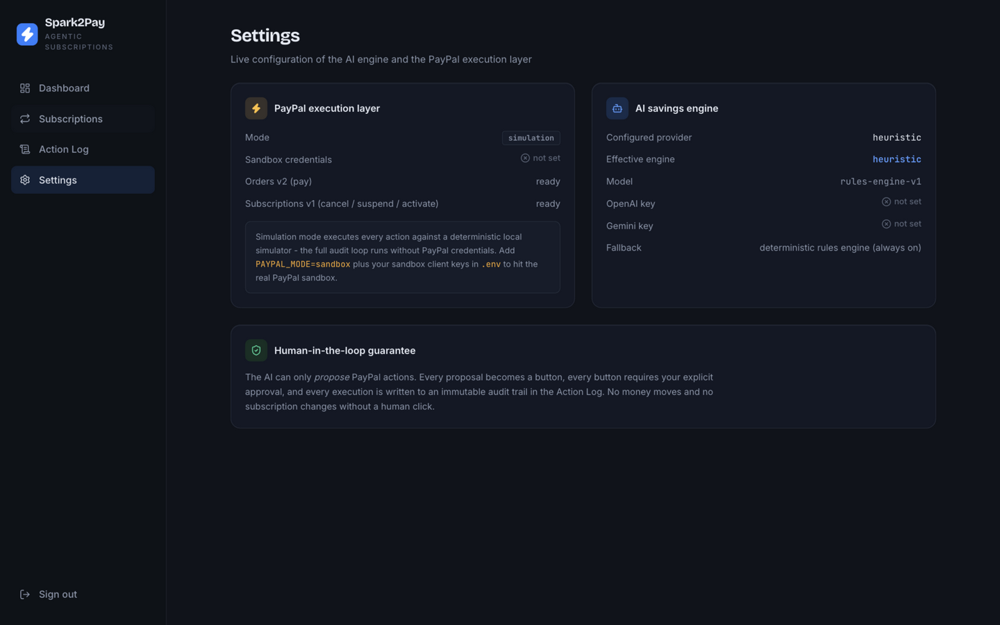

# ⚡ Spark2Pay


**The agentic subscription manager.** AI finds the waste. PayPal executes the savings.



Spark2Pay is a subscription manager whose AI doesn't stop at *advice*. When the
savings engine concludes "this subscription should be cancelled", it renders a
**Manage with PayPal** button on the advice card. One click takes you through a
PayPal approval step, executes the cancellation (or payment) through PayPal's
APIs, writes an immutable audit record, and marks the subscription cancelled in
your tracker — a closed loop from *insight* to *action*.

> Built for the [PayPal AI Hackathon](https://paypalaihackathon.devpost.com).

---

## Screenshots

The full agentic loop, as captured live against the simulation backend:

| Step | Screenshot |
|------|------------|
| **1. Sign in** — demo account, zero-config |  |
| **2. AI advice** — savings opportunities with executable PayPal actions |  |
| **3. Human approval** — the AI proposes, you decide |  |
| **4. Executed** — savings count-up with the spark pulse |  |
| **5. Audit trail** — every attempt recorded with PayPal references |  |
| **6. Closed loop** — the subscription is now marked cancelled |  |
| **7. Live configuration** — AI engine + PayPal layer status |  |

## Why it matters

Every subscription tracker tells you *what* to cancel. Then you have to log in
to Netflix, hunt for the cancellation page, and do it yourself. Spark2Pay's AI
agent closes that last mile:

```
┌──────────────┐     ┌───────────────────────┐     ┌──────────────────────┐
│  PERCEIVE    │     │  ANALYZE (AI agent)   │     │  EXECUTE (PayPal)    │
│ Subscription │ ──▶ │ Heuristic rules  or   │ ──▶ │ Orders v2 · Subs v1  │
│ subs, usage, │     │ LLM function calling  │     │ approve → capture /  │
│ billing      │     │ (OpenAI / Gemini /    │     │ cancel / suspend     │
│ cycles       │     │  Ollama — pluggable)  │     │                      │
└──────────────┘     └───────────┬───────────┘     └──────────┬───────────┘
                                 │  tool call = PROPOSAL      │
                                 │  (human-in-the-loop)       │
                     ┌───────────▼────────────────────────────▼───────────┐
                     │  AUDIT: every attempt persisted to paypal_actions   │
                     │  CLOSED LOOP: execution writes back to the tracker  │
                     └────────────────────────────────────────────────────┘
```

**Safety by design:** the LLM can only *propose* PayPal actions via function
calling. Every proposal becomes a button. Every button requires an explicit
human approval. Every execution lands in an audit trail.

## Features

- **AI savings engine** — a deterministic rules engine (long-term unused,
  duplicate category coverage, costly underuse) plus an optional LLM agent
  (OpenAI, Gemini or Ollama through one OpenAI-compatible client) that proposes
  `manage_with_paypal` tool calls. Works with zero API keys.
- **PayPal execution layer** — Orders v2 (create/capture) and Subscriptions v1
  (cancel/suspend/activate) behind one interface, with OAuth token caching,
  idempotency handling (`ORDER_ALREADY_CAPTURED`, re-cancel), and webhook
  verification (`PAYMENT.CAPTURE.COMPLETED`, `BILLING.SUBSCRIPTION.CANCELLED`).
- **`sandbox` / `simulation` dual mode** — point `PAYPAL_MODE` at real PayPal
  sandbox credentials, or run the deterministic local simulator with zero
  credentials. Identical code path, identical audit trail.
- **Full subscription tracking** — flexible billing cycles, multi-
  currency, budgets, categories, household members, 9 notification channels.
- **Action Log** — every PayPal attempt with status, PayPal references, mode,
  and savings.
- **Bespoke dark UI** — React 18 + TypeScript + Tailwind, hand-tuned design
  system (Bricolage Grotesque / Inter / JetBrains Mono), micro-interactions,
  and a savings count-up "dealt moment" when PayPal completes an action.

## Quickstart

Prerequisites: Python 3.11+ (3.9 works too), Node 18+.

```bash
# 1. Backend
cd backend
python -m venv .venv && source .venv/bin/activate    # Windows: .venv\Scripts\activate
pip install -r requirements.txt
cp .env.example .env                                 # defaults just work
python seed_demo.py                                  # creates tables + demo data

python run.py                                        # serves http://localhost:3038

# 2. Frontend (new terminal)
cd frontend
npm install
npm run dev                                          # serves http://localhost:5173
```

Open **http://localhost:5173** and sign in with the demo account:

```
username: demo
password: Spark2Pay2026
```

The demo portfolio is shaped so the AI immediately surfaces four savings
opportunities — three executable through PayPal, one intentionally card-billed
to show the honest manual path.

### Run the tests

```bash
cd backend
python -m pytest tests/ -q          # 33 tests: execution layer, AI engine, API loop
cd ../frontend
npm run build                       # strict TypeScript + production build
```

## Connecting the real PayPal sandbox

1. Create an account at the [PayPal Developer Dashboard](https://developer.paypal.com/dashboard/).
2. Under **Apps & Credentials** → **Sandbox**, create a REST API app and copy
   the **Client ID** and **Secret**.
3. In `backend/.env`:
   ```
   PAYPAL_MODE=sandbox
   PAYPAL_CLIENT_ID=<your client id>
   PAYPAL_CLIENT_SECRET=<your secret>
   ```
4. Restart the backend. Cancel/suspend/activate now hit
   `api-m.sandbox.paypal.com` against PayPal-managed subscriptions; pay actions
   open the real PayPal approval window (use a
   [sandbox buyer account](https://developer.paypal.com/dashboard/accounts)).

Without credentials, `PAYPAL_MODE=simulation` (the default) executes every
action against a deterministic local simulator — the full loop, audit included,
works offline. This is also how the automated tests run.

## AI engine configuration

| Provider | Env | Notes |
|----------|-----|-------|
| Rules engine (default fallback) | `AI_PROVIDER=heuristic` | No keys, deterministic, always available |
| OpenAI | `AI_PROVIDER=openai` + `OPENAI_API_KEY` | Function calling with the `manage_with_paypal` tool |
| Gemini | `AI_PROVIDER=gemini` + `GOOGLE_GEMINI_API_KEY` | Same OpenAI-compatible protocol |
| Ollama (local) | `AI_PROVIDER=ollama` + `OLLAMA_HOST` | Same protocol, no key |

`AI_PROVIDER=auto` (default) uses OpenAI when a key is present, otherwise the
rules engine. Any LLM failure falls back to heuristics, so the product never
breaks because a model is down.

## Key API endpoints

```
GET  /api/v1/ai/recommendations          AI advice (engine + rationale + savings)
GET  /api/v1/ai/status                   engine + PayPal layer status
POST /api/v1/paypal/actions              begin an action → approve_link + audit id
POST /api/v1/paypal/actions/<id>/complete  execute after approval (capture/cancel)
POST /api/v1/paypal/actions/<id>/reject    record a user rejection
GET  /api/v1/paypal/actions              the audit trail
POST /api/v1/paypal/webhook              PayPal events (signature-verified)
```

## Project structure

```
spark2pay/
├── backend/
│   ├── app/
│   │   ├── api/v1/            # auth, subscriptions, ... + ai.py, paypal.py (new)
│   │   ├── models/            # subscription & audit models (paypal_action, usage)
│   │   ├── services/
│   │   │   ├── ai_service.py      # heuristic advisor + LLM function calling
│   │   │   ├── paypal_service.py  # sandbox|simulation execution layer
│   │   │   └── ...                # billing cycles, notifications, statistics
│   │   └── config.py          # + PayPal / AI settings
│   ├── tests/                 # NEW: 33 pytest cases
│   └── seed_demo.py           # NEW: demo portfolio
└── frontend/                  # NEW: React 18 + TS + Tailwind app
    └── src/
        ├── components/        # AdviceCard, PayPalActionButton, ...
        ├── pages/             # Dashboard, Subscriptions, ActionLog, Settings
        │   └── paypal/        # approval / return / cancel flow pages
        └── lib/               # API client, formatting
```

## Documentation

- [SUBMISSION.md](SUBMISSION.md) — hackathon submission: description, tools
  list, judging-criteria mapping, demo video script.
- [LICENSE](LICENSE) — MIT.
